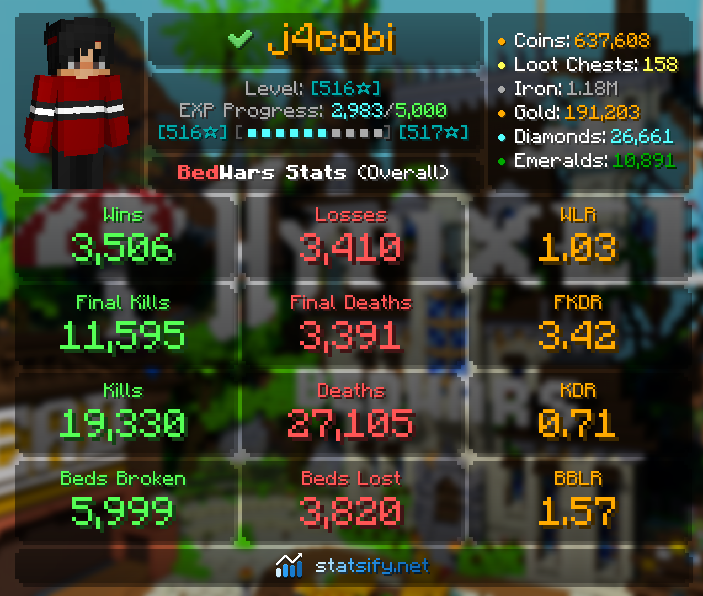
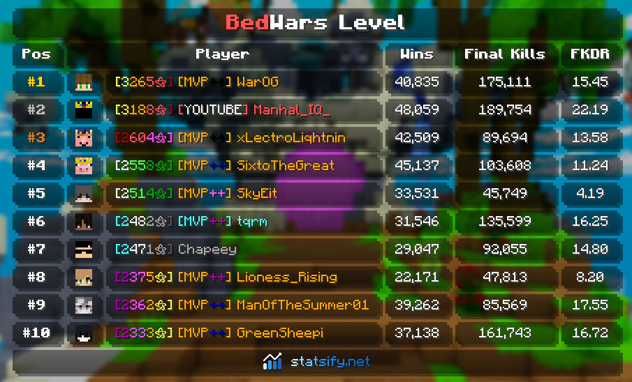
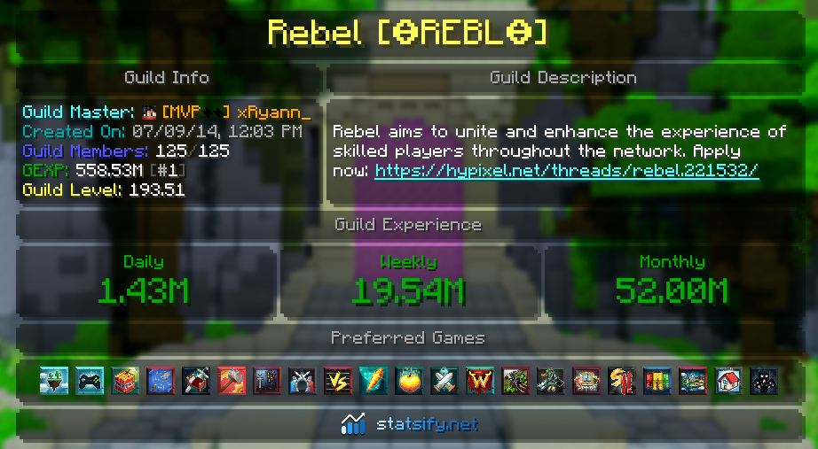
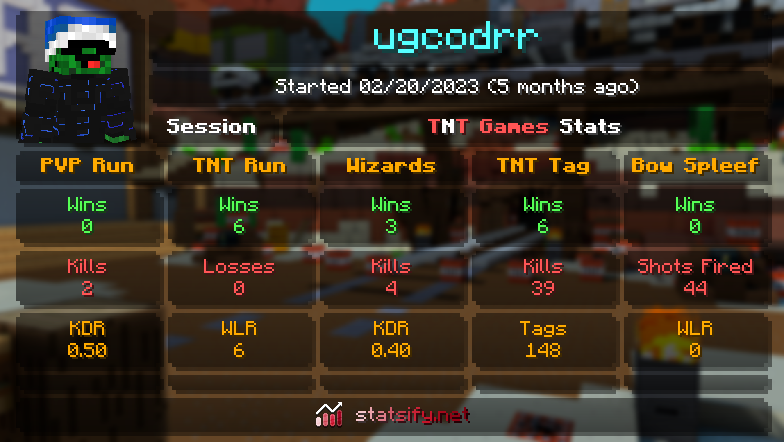

<div align="center">


# Statsify
A Hypixel and Minecraft focused Discord Bot

</div>

## 💻 Developing
### ⚒️ Requirements
-   [`Node.js`]: For running code (`24.7.0`)
-   [`Rust`]: For skin rendering (`v1.89.0`)
-   [`Wasm Pack`]: For skin rendering on the web (`v0.12.1`)
-   [`pnpm`]: Installing packages and running scripts (`npm install -g pnpm`)
-   [`MongoDB`]: For Persistent data ([`Atlas`])
-   [`Redis`]: For Leaderboards ([`Redis Cloud`])
-   [`RediSearch`]: For Autocomplete *optional*
-   [`Hypixel API Key`]: For requesting Hypixel data, create an API Key on [developer.hypixel.net](https://developer.hypixel.net/dashboard)


### 🖼️ Assets
* Public assets for development are included in `assets/public`
* In addition, you must provide a 1.8.9 texture pack in the `assets/public/minecraft-textures/default`

### 🚀 Running
* The codebase is split into apps and packages
* Set up a `config.js` file in the root of the project following the `config.schema.js` file (copy paste it over and fill it in)
* Pull the git submodules (`git submodule update --init`)
* Use `pnpm build` to build all packages and apps,
* Use `pnpm build:watch` to watch files and build them while you code
* Use `pnpm {appName} start` to run an app, eg `pnpm api start` to run the API

### 🤖 Other Important commands
```bash
# Change things in a package/app
$ pnpm workspace {app or package name} {command}

# Example: Adding a dependency
$ pnpm workspace {app or package name} add {dependency}

# Linting
$ pnpm lint

# Testing
$ pnpm test

# Type Testing
$ pnpm typecheck

# Building an app's Docker image (needs the private assets)
$ docker build --platform linux/amd64 --build-arg APP={app name} .
```

## 🚢 Deploying
* Pushing a `v*` tag builds an image for each production app and runs them on the server with `compose.prod.yml`
* The apps read the server's `/home/config.js`, mounted read-only, so restart them after changing it
* Run compose commands from the deploy checkout, where `.env` holds the deployed commit

```bash
# Building and starting every app
$ docker compose -f compose.prod.yml up -d --build

# Following an app's logs
$ docker compose -f compose.prod.yml logs -f {service name}

# Restarting or stopping an app
$ docker compose -f compose.prod.yml restart {service name}
$ docker compose -f compose.prod.yml stop {service name}
```

## 💁 Contributing
* Follow the guidelines in [`.github/CONTRIBUTING.md`](.github/CONTRIBUTING.md)
* If you are unsure of anything join our [`Discord`] and then message, `@jacobkoshy`


## 😕 Help
* If you require support join our [`Discord`] and create a ticket in the `#create-ticket` channel

## 🔗 Links
- [`Website`]
- [`Bot Invite`]
- [`Discord`]
- [`Donate`]

## Showcase
<div align="center">






</div>


<!-- LINKS -->
[`website`]: https://statsify.net
[`bot invite`]: https://statsify.net/invite
[`discord`]: https://statsify.net/discord
[`donate`]: https://statsify.net/donate
[`node.js`]: https://nodejs.org/en/download/current/
[`rust`]: https://rustup.rs/
[`redis`]: https://redis.io
[`mongodb`]: https://www.mongodb.com/
[`hypixel api key`]: https://api.hypixel.net
[`pnpm`]: https://pnpm.io/
[`atlas`]: https://www.mongodb.com/cloud/atlas/register
[`redis cloud`]: https://redis.com/try-free/
[`redisearch`]: https://redis.io/docs/stack/search/quick_start/
[`wasm pack`]: https://rustwasm.github.io/wasm-pack/